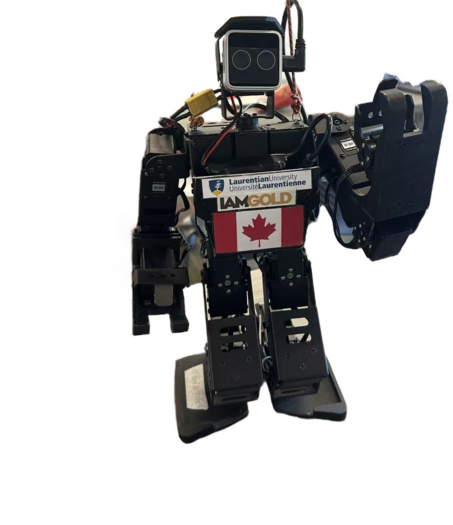
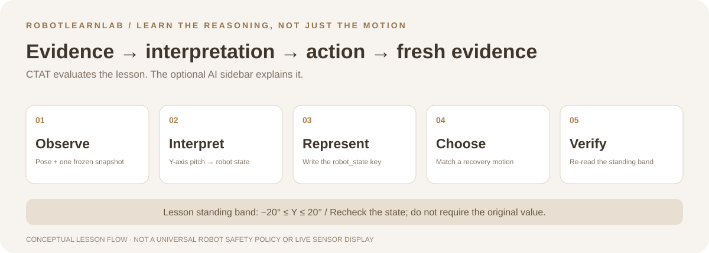

<div align="center">

# RobotLearnLab

### Before a robot stands up, its operator needs to know why.

An intelligent tutoring system for reasoning from a humanoid robot's pose and IMU evidence to a recovery action, then checking the result.

**CTAT example tracing · 10-question lesson · Optional AI explanations**

[Run in CTAT](#run-the-tutor-in-ctat) · [Learning flow](#from-observation-to-verification) · [Recovery policy](#recovery-policy) · [Safety and limits](#safety-and-integration-boundaries)

</div>

<p align="center"></p>
<p align="center"><sub>Existing AINEX robot asset from the tutor interface, not a new simulation or lesson screenshot.</sub></p>

Built for the **Intelligent Tutoring System (ITS) track at the CMU 2026 LearnLab Summer School**, RobotLearnLab combines a CMU CTAT example-tracing lesson with an optional generative-AI “robot digital twin.” The behavior graph evaluates student steps. The AI sidebar explains reasoning; it does not control lesson progression or directly command the robot.

> [!IMPORTANT]
> This is a teaching prototype, not an autonomous fall-recovery controller. Its pitch thresholds and motion mappings are the included lesson's policy, not a universal safety rule for other robots. Physical robot work requires appropriate supervision, support, and a clear movement area.

## Run the tutor in CTAT

No Node.js build or package installation is required. You need CTAT Authoring Tools and internet access for the referenced CTAT CDN assets and Google Fonts.

```bash
git clone https://github.com/yuzhang-zhong/RobotLearnLab.git
cd RobotLearnLab
```

1. Keep `HTML/` and `FinalBRDs/` as sibling directories.
2. Import the V10 package as a new project in [CTAT Authoring Tools](https://github.com/CMUCTAT/CTAT/wiki).
3. Open `HTML/recovery-from-fall-v10.html`.
4. Start with the observation question and use **Hint** for progressively more specific guidance. The optional AI sidebar can remain disconnected.

The HTML explicitly binds to `../FinalBRDs/recovery-from-fall-v10.brd`, so an older `question_file` parameter cannot silently select a previous lesson version. Simply viewing the HTML without the CTAT runtime is not a full tutor test.

## From observation to verification



The key lesson is **evidence → interpretation → action → fresh evidence**, not memorizing a motion name. Five visual-observation lanes cross five IMU classifications, allowing agreement and conflict feedback instead of assuming the initial visual guess was right.

The included [behavior graph](FinalBRDs/recovery-from-fall-v10.brd) contains **75 nodes, 150 edges, and 125 complete correct paths**. These describe the graph's structure, not measured learning gains or a user-study result.

## What students learn

The tutor guides students through a ten-question evidence-to-action workflow:

1. Observe and classify the robot's pose.
2. Identify the IMU as the primary fall sensor.
3. Inspect the live IMU stream with `rostopic echo /imu_gui`.
4. Use the Y-axis pitch angle to detect front and back falls.
5. Record a frozen sensor snapshot.
6. Map the pitch interval to a robot state.
7. Select the `robot_state` blackboard key.
8. Write the interpreted state to the blackboard.
9. Select the matching recovery motion.
10. Re-read the robot state and verify recovery using the standing band rather than exact equality with the original sensor reading.

## Recovery policy

| Y-axis pitch | Interpreted state | Recovery action |
| --- | --- | --- |
| `Y <= -90°` | `fall_front` | `recline_to_stand.d6a` |
| `-90° < Y < -20°` | `leaning_forward` | No action |
| `-20° <= Y <= 20°` | `stand` | No action |
| `20° < Y < 90°` | `leaning_backward` | No action |
| `Y >= 90°` | `fall_back` | `lie_to_stand.d6a` |

The lesson emphasizes that IMU integration drift can shift the post-recovery reading. A safe recovery is therefore judged by the standing band, `-20° <= Y <= 20°`, instead of requiring the sensor to return to its original value.

## What the tutor does

| Component | Responsibility | Boundary |
| --- | --- | --- |
| CTAT behavior graph | Evaluate responses, track lesson progress, provide targeted feedback and hints | Runs the lesson logic, not the physical robot |
| Evidence-to-policy exercise | Connect visual pose, sensor readings, `robot_state`, motion selection, and verification | Uses the snapshot entered by the student |
| Optional AI digital twin | Explain IMU thresholds, ROS commands, drift, and recovery reasoning in the student's language | No claimed live robot access; no authority over progression |

## Optional Robot Digital Twin

The right-hand sidebar can call the OpenAI Responses API as an optional source of explanations:

1. For private testing only, open the tutor page.
2. Paste an OpenAI project API key into the password field.
3. Change the model name if needed; the prototype defaults to `gpt-4o-mini`.
4. Select **Connect**, then ask a question.

Model calls may incur API charges. No API key is included in this repository. The browser keeps the entered key only in JavaScript memory for the current page session and does not write it to a file or `localStorage`.

> [!WARNING]
> The direct browser-to-API integration is intended only for private testing. For a shared or production deployment, send requests through a server-side proxy so students never handle or expose a reusable API key. The host must also allow HTTPS connections to `https://api.openai.com` through its Content Security Policy and network rules.

## Safety and integration boundaries

- **Sensor adapter not included.** The HTML/BRD tutor cannot independently read a frozen snapshot from a separate Robot Sensor Viewer. The student's Y value selects the behavior-graph branch, but exact X/Z equality cannot be enforced without an adapter that sends the frozen values into CTAT.
- **The sidebar is optional.** The CTAT lesson does not need an OpenAI API key; explanations require an enabled model, network access, and account quota.
- **Keep reusable keys out of shared deployments.** Session-memory storage is not a production credential architecture. Use a server-side proxy for shared use, and do not include keys in repositories, screenshots, or logs.
- **Verification uses a band, not exact equality.** IMU integration drift can change the reading after recovery. Reassess the fresh state rather than assuming the movement succeeded.

## Repository guide and stack

| File / directory | Purpose |
| --- | --- |
| [`HTML/recovery-from-fall-v10.html`](HTML/recovery-from-fall-v10.html) | Vanilla HTML lesson and CTAT initialization |
| [`HTML/Assets/recovery-from-fall-styles-v10.css`](HTML/Assets/recovery-from-fall-styles-v10.css) | Tutor layout and styling |
| [`HTML/Assets/robot-digital-twin-v10.js`](HTML/Assets/robot-digital-twin-v10.js) | Optional OpenAI Responses API client, default `gpt-4o-mini` |
| [`FinalBRDs/recovery-from-fall-v10.brd`](FinalBRDs/recovery-from-fall-v10.brd) | CTAT example-tracing graph |
| [`README.txt`](README.txt) | Package notes, V10 component contracts, and compatibility detail |

The lesson references ROS via `rostopic echo /imu_gui`. The HTML/CSS/JavaScript package has no build step. Proprietary font binaries are not redistributed; the page references web-font fallbacks.

## Team

- Yuzhang Zhong
- Xingyu Zheng
- Yixin Zhang

Developed for the ITS track at the CMU 2026 LearnLab Summer School.

## Acknowledgments

- [CMU Cognitive Tutor Authoring Tools (CTAT)](https://github.com/CMUCTAT/CTAT)
- AINEX humanoid robot platform
- OpenAI Responses API for the optional digital-twin tutor

## License

[MIT](LICENSE).
