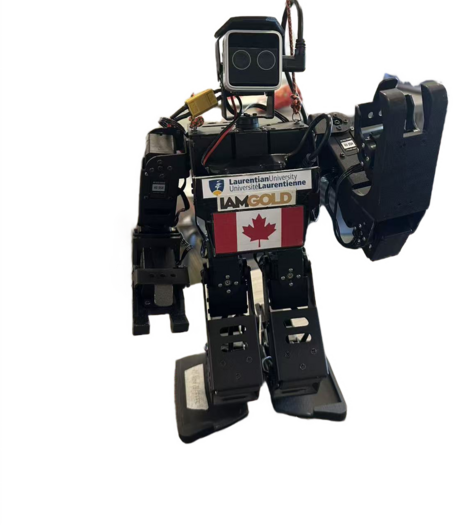
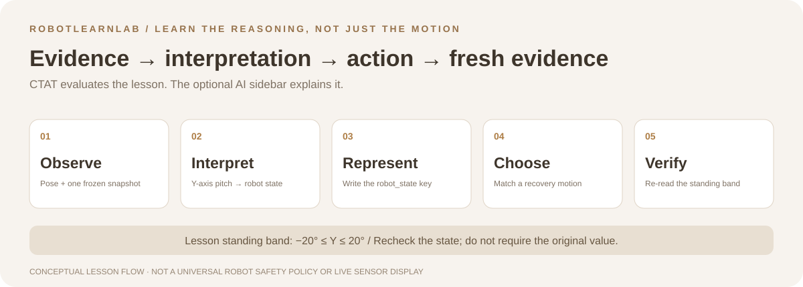

<div align="center">

# RobotLearnLab

**学习判断人形机器人为何跌倒，并用新证据确认恢复结果。**

从姿态与 IMU 读数推理机器人状态、选择恢复动作的智能教学系统。

[English](README.md) · **简体中文**

[](FinalBRDs/recovery-from-fall-v10.brd)
[](LICENSE)

[在 CTAT 中运行](#run-the-tutor-in-ctat) · [学习流程](#from-observation-to-verification) · [恢复策略](#recovery-policy) · [可选 AI 解释](#optional-robot-digital-twin) · [安全与限制](#safety-and-integration-boundaries)

</div>

RobotLearnLab 为 **CMU 2026 LearnLab Summer School 的 Intelligent Tutoring System（ITS）方向**开发，将 CMU CTAT 示例追踪课程与可选的生成式 AI“机器人数字孪生”结合起来。行为图判断学生的操作；AI 侧栏解释推理，不控制课程进度，也不直接向机器人下达动作指令。

> [!IMPORTANT]
> 这是教学原型，不是自主跌倒恢复控制器。俯仰阈值与动作映射属于本课程的策略，不能直接当作其他机器人的通用安全规则。实际操作机器人需要适当监督、支撑，以及无障碍的运动区域。

<a id="run-the-tutor-in-ctat"></a>
## 在 CTAT 中运行课程

不需要 Node.js 构建或安装软件包。需要 CTAT Authoring Tools，以及能够加载 CTAT CDN 资源和 Google Fonts 的网络。

```bash
git clone https://github.com/yuzhang-zhong/RobotLearnLab.git
cd RobotLearnLab
```

1. 保持 `HTML/` 与 `FinalBRDs/` 为同级目录。
2. 将 V10 包作为新项目导入 [CTAT Authoring Tools](https://github.com/CMUCTAT/CTAT/wiki)。
3. 打开 `HTML/recovery-from-fall-v10.html`。
4. 从观察题开始，需要帮助时使用 **Hint** 获取逐步具体化的提示。可选 AI 侧栏可以保持未连接状态。

HTML 明确绑定到 `../FinalBRDs/recovery-from-fall-v10.brd`，旧的 `question_file` 参数不能悄悄切换到旧版课程。没有 CTAT 运行环境时，单独打开 HTML 不等于完成了教学系统测试。

<a id="from-observation-to-verification"></a>
## 从观察到验证

<p align="center"></p>
<p align="center"><sub>课程界面的现有 AINEX 素材，不是新生成的模拟或课程运行截图。</sub></p>



课程练习的是**证据 → 解释 → 动作 → 新证据**，而不只是记住动作名称。五种视觉观察分支与五种 IMU 分类交叉，既能反馈一致判断，也能指出证据冲突，不默认最初的视觉猜测正确。

[行为图](FinalBRDs/recovery-from-fall-v10.brd)包含 **75 个节点、150 条边和 125 条完整正确路径**。这些数字描述图的结构，不代表实测学习增益或用户研究结果。

<a id="what-students-learn"></a>
## 学习内容

十道题沿着同一条证据到动作的流程展开：

| 观察 | 解释 | 动作与验证 |
| --- | --- | --- |
| 判断姿态，记录 IMU 证据 | 将俯仰角映射到状态，再写入黑板 | 选择动作，重新读取证据，检查站立区间 |

<details>
<summary>展开查看全部十个步骤</summary>

1. 观察并判断机器人的姿态。
2. 确认 IMU 是主要的跌倒传感器。
3. 用 `rostopic echo /imu_gui` 查看实时 IMU 流。
4. 用 Y 轴俯仰角识别向前、向后跌倒。
5. 记录一份冻结的传感器快照。
6. 将俯仰区间映射为机器人状态。
7. 选择 `robot_state` 黑板键。
8. 把解释得到的状态写入黑板。
9. 选择对应的恢复动作。
10. 重新读取机器人状态，用站立区间验证恢复，而不是要求读数与最初值精确相等。

</details>

<a id="recovery-policy"></a>
## 恢复策略

| Y 轴俯仰角 | 解释状态 | 恢复动作 |
| --- | --- | --- |
| `Y <= -90°` | `fall_front` | `recline_to_stand.d6a` |
| `-90° < Y < -20°` | `leaning_forward` | 不执行动作 |
| `-20° <= Y <= 20°` | `stand` | 不执行动作 |
| `20° < Y < 90°` | `leaning_backward` | 不执行动作 |
| `Y >= 90°` | `fall_back` | `lie_to_stand.d6a` |

IMU 积分漂移可能使恢复后的读数发生变化。因此，课程以 `-20° <= Y <= 20°` 的站立区间作为判断依据，不要求传感器精确回到原始值。

<a id="what-the-tutor-does"></a>
## 各部分负责什么

| 组成 | 职责 | 边界 |
| --- | --- | --- |
| CTAT 行为图 | 判断回答、记录进度，提供针对性的反馈与提示 | 运行课程逻辑，不控制实体机器人 |
| 证据到策略练习 | 连接视觉姿态、传感器读数、`robot_state`、动作选择与验证 | 使用学生录入的快照 |
| 可选 AI 数字孪生 | 用学生使用的语言解释 IMU 阈值、ROS 命令、漂移与恢复推理 | 不声称拥有实时机器人访问权限，也无权决定课程进度 |

<a id="optional-robot-digital-twin"></a>
## 可选机器人数字孪生

右侧栏可选接入 OpenAI Responses API，辅助解释课程内容：

1. 仅在私人测试环境中打开课程页面。
2. 将 OpenAI 项目 API key 输入密码框。
3. 按需更改模型名称；原型默认使用 `gpt-4o-mini`。
4. 选择 **Connect**，再输入问题。

模型调用可能产生 API 费用。仓库不包含 API key。页面只在当前会话的 JavaScript 内存中保留输入的 key，不写入文件或 `localStorage`。

> [!WARNING]
> 浏览器直连 API 的方式只适用于私人测试。共享或生产部署应通过服务端代理发起请求，避免学生接触或暴露可重复使用的 API key。宿主的 Content Security Policy 和网络规则也必须允许访问 `https://api.openai.com`。

<a id="safety-and-integration-boundaries"></a>
## 安全与集成边界

- **不包含传感器适配器。** HTML/BRD 课程无法独立读取另一个 Robot Sensor Viewer 中冻结的快照。学生输入的 Y 值选择行为图分支；若要强制检查 X/Z 是否精确相等，需要适配器将冻结值发送给 CTAT。
- **AI 侧栏可选。** CTAT 课程本身不需要 OpenAI API key；AI 解释需要可用模型、网络与账户额度。
- **共享部署不能暴露重复使用的 key。** 会话内存存储不等于生产级凭据方案。共享使用应采用服务端代理，且不得把 key 放进仓库、截图或日志。
- **验证使用区间，不是精确相等。** IMU 积分漂移可能改变恢复后的读数。应重新评估新状态，不能直接假设动作已经成功。

<a id="repository-guide-and-stack"></a>
## 仓库入口与技术

- [`HTML/recovery-from-fall-v10.html`](HTML/recovery-from-fall-v10.html)：原生 HTML 课程与 CTAT 初始化。
- [`HTML/Assets/recovery-from-fall-styles-v10.css`](HTML/Assets/recovery-from-fall-styles-v10.css)：课程布局和样式。
- [`HTML/Assets/robot-digital-twin-v10.js`](HTML/Assets/robot-digital-twin-v10.js)：可选 OpenAI Responses API 客户端，默认 `gpt-4o-mini`。
- [`FinalBRDs/recovery-from-fall-v10.brd`](FinalBRDs/recovery-from-fall-v10.brd)：CTAT 示例追踪图。
- [`README.txt`](README.txt)：包说明、V10 组件约定与兼容性细节。

课程通过 `rostopic echo /imu_gui` 引用 ROS。HTML/CSS/JavaScript 包不需要构建。仓库不分发专有字体二进制，页面引用网络字体作为回退。

<a id="team"></a>
## 团队

- Yuzhang Zhong
- Xingyu Zheng
- Yixin Zhang

为 CMU 2026 LearnLab Summer School 的 ITS 方向开发。

<a id="acknowledgments"></a>
## 致谢

- [CMU Cognitive Tutor Authoring Tools（CTAT）](https://github.com/CMUCTAT/CTAT)
- AINEX 人形机器人平台
- 用于可选数字孪生解释的 OpenAI Responses API

<a id="license"></a>
## 许可

[MIT](LICENSE)。
